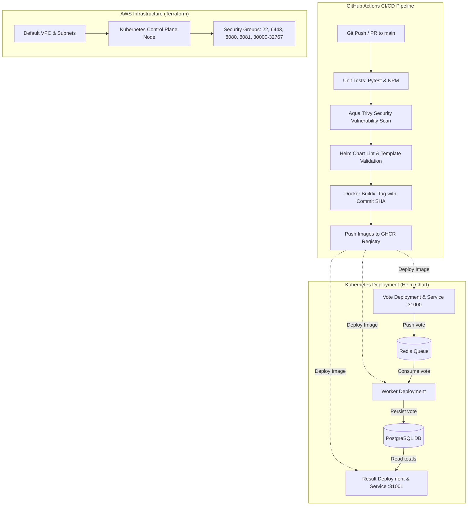

# DevOps Capstone 1: Ship It — Example Voting App

**Author:** Faruk Olawale  
**Course:** DevOps Capstone Projects (Beginner Edition: Ship It and Keep It Running)  
**Instructor:** Toluwalase Adedotun  

---

## Architecture Overview



---

## 1. Run Locally (Docker Compose)

The application can be run locally using Docker Compose to verify full end-to-end voting data flow:

```bash
# Build and start all services in detached mode
docker compose up -d --build

# Verify container health
docker compose ps
```

- **Vote UI**: [http://localhost:8080](http://localhost:8080)
- **Result UI**: [http://localhost:8081](http://localhost:8081)

### Test the Voting Flow via CLI
```bash
# Cast a vote for Option A
curl -s -X POST -d "vote=a" --cookie "voter_id=cli_voter_1" http://localhost:8080/

# Verify vote reached PostgreSQL
docker compose exec -T db psql -U postgres -d postgres -c "SELECT * FROM votes;"

# Stop local services
docker compose down
```

---

## 2. Container Hardening & Security (Least Privilege)

Every container in this repository has been hardened in accordance with production container security best practices:

1. **Pinned Base Images**:
   - `vote`: Pinned to `python:3.11.9-slim-bookworm` (eliminates drift from mutable `latest` tags).
   - `result`: Pinned to `node:18.20.4-slim`.
   - `worker`: Pinned compilation to `mcr.microsoft.com/dotnet/sdk:7.0.410` and runtime to `mcr.microsoft.com/dotnet/runtime:7.0.20`.
2. **Non-Root Execution**:
   - Dedicated unprivileged system users (`appuser` with UID `10001` for Python/.NET, and `node` with UID `1000` for Node.js).
   - Root privilege is stripped at build time; containers run with least privilege.
3. **Non-Privileged Port Binding**:
   - Applications listen on unprivileged ports (`8080` for vote, `8081` for result), preventing container runtime permission errors under Kubernetes security contexts.
4. **Layer Optimization & `.dockerignore`**:
   - Dedicated `.dockerignore` files in each service directory prevent build cache pollution, sensitive file leakage, and bloated image sizes.

---

## 3. Kubernetes Infrastructure with Terraform

The infrastructure code in [`terraform/`](terraform/) provisions an automated, reproducible Kubernetes cluster directly inside the AWS **Default VPC**, as specified by the project brief.

### Provisioning the Cluster
```bash
cd terraform

# Initialize providers
terraform init

# Review execution plan
terraform plan

# Apply infrastructure changes
terraform apply -auto-approve
```

### Outputs
- `cluster_public_ip`: Public IP of the Kubernetes instance.
- `kubeconfig_fetch_command`: Ready command to copy the cluster kubeconfig to your local machine:
  ```bash
  scp -i voting-app-k8s.pem -o StrictHostKeyChecking=no ubuntu@<PUBLIC_IP>:/etc/rancher/k3s/k3s.yaml ./kubeconfig
  sed -i 's/127.0.0.1/<PUBLIC_IP>/g' ./kubeconfig
  export KUBECONFIG=$(pwd)/kubeconfig
  ```
- `vote_url`: `http://<PUBLIC_IP>:31000`
- `result_url`: `http://<PUBLIC_IP>:31001`

### Teardown (Reproducibility)
To completely destroy the infrastructure and verify clean recreation:
```bash
terraform destroy -auto-approve
```

---

## 4. Automated CI/CD Pipeline (GitHub Actions)

The workflow at [`.github/workflows/ci-cd.yaml`](.github/workflows/ci-cd.yaml) executes automatically on every `push` and `pull_request` to `main`:

1. **Automated Testing**:
   - Executes Python unit tests with `pytest` for the `vote` service.
   - Runs syntax and unit validation with `npm test` for the `result` service.
2. **Aqua Security Trivy Scan**:
   - Scans the repository filesystem and Dockerfiles for HIGH and CRITICAL vulnerabilities and misconfigurations.
3. **Helm Lint**:
   - Validates the Helm chart syntax and template generation via `helm lint` and `helm template`.
4. **Buildx Build, Tag & Push**:
   - Tags every image with the exact Git commit SHA (`${{ github.sha }}`) for deterministic provenance and traceability.
   - Pushes images securely to the GitHub Container Registry (`ghcr.io`) using short-lived `${{ secrets.GITHUB_TOKEN }}` (no static secrets stored in Git).

---

## 5. Helm Deployment & Live Rollback Drill

The unified Helm chart in [`charts/voting-app/`](charts/voting-app/) packages the entire application stack managed by a single [`values.yaml`](charts/voting-app/values.yaml).

### Install Release
```bash
helm install voting-app ./charts/voting-app
```

### Verify Running Pods & Services
```bash
kubectl get pods,svc -o wide
```

### Live Rollback Demonstration

#### Step 1: Simulate a Faulty Release
Deploy an intentionally broken release with an invalid image tag:
```bash
helm upgrade voting-app ./charts/voting-app \
  --reuse-values \
  --set vote.image.tag=broken-tag-v999 \
  --set vote.image.pullPolicy=Always
```

Notice the new pod fails with `ErrImagePull` or `ImagePullBackOff`:
```bash
kubectl get pods
```

#### Step 2: Instant Rollback
Roll back to the previous healthy revision:
```bash
# Check release history
helm history voting-app

# Roll back to healthy revision
helm rollback voting-app 1

# Confirm all pods return to Running state
kubectl get pods
```

---

## 6. Deliverables Checklist ("Done Means")

- [x] **Forked Repository**: Codebase cleanly adapted and pushed to personal fork.
- [x] **Safe Containerization**: Base images pinned, non-root users enforced, `.dockerignore` configured.
- [x] **Terraform Infrastructure**: Fully reproducible Kubernetes cluster code in AWS Default VPC.
- [x] **GitHub Actions Pipeline**: Tests, Aqua Trivy security scanning, Docker Buildx with Git commit SHA tagging.
- [x] **Single Helm Chart**: Unified chart with single `values.yaml` controlling all 5 services.
- [x] **Live Rollback**: Rollback drill tested and documented.
- [x] **Zero Secrets in Git**: No AWS credentials, private keys, or credentials stored in repository.
- [x] **Clear Documentation**: Comprehensive guide and architecture diagram.
